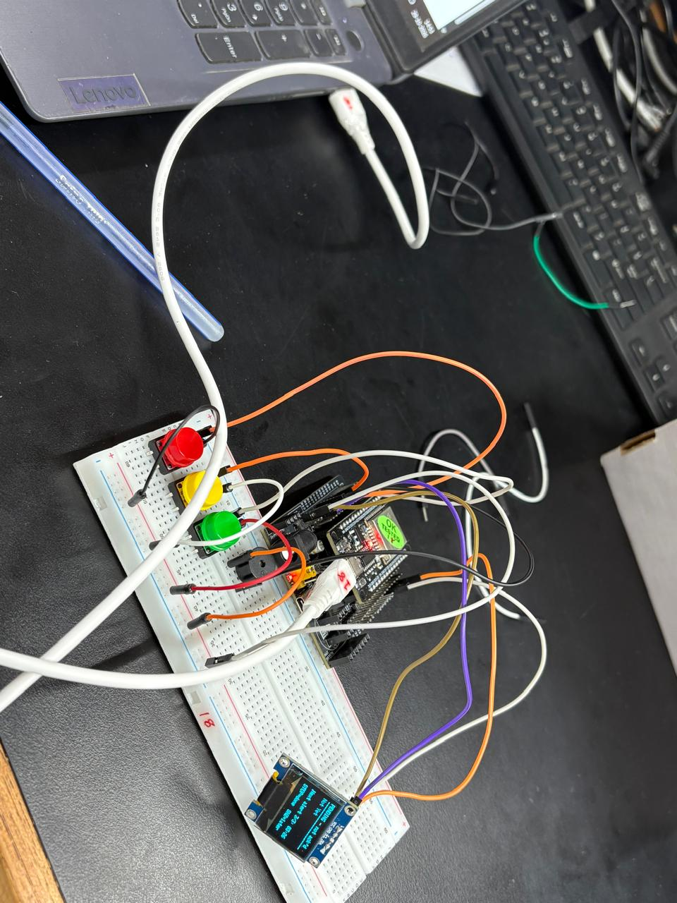

# Smart Daily Reminder Assistant (ESP32 Edge IoT)

> An offline, edge-computing daily reminder and timetable assistant built on the ESP32 — zero cloud, zero internet required.



## Live Demo
<!-- Quick Upgrade: After pushing, edit README.md on GitHub and drag-and-drop media/IOT_LIVE_demonstration.mp4 right here (it is 4.16 MB, so GitHub will render an inline playable video player). -->
[Watch the Live Hardware Demo (MP4)](media/IOT_LIVE_demonstration.mp4)

## Overview & Problem Statement
Students and professionals juggle classes, exams, assignments, and meetings daily, yet most smart reminder devices depend on cloud databases, API keys, and constant internet connectivity. **Smart Daily Reminder Assistant** moves storage, scheduling, and alert control directly onto the ESP32. The board hosts its own Wi-Fi access point (`SmartReminder`) and local browser dashboard (`http://192.168.4.1`) while saving all schedules persistently in LittleFS flash memory (`/reminders.json`).

## Key Features
- **100% Offline Edge Architecture:** No external server, cloud account, or internet router required.
- **Local Web Dashboard (`192.168.4.1`):** Add individual reminders, bulk-import entire timetables, mark items done, or clear completed/missed entries from any phone or laptop browser.
- **Persistent Flash Storage:** Stores up to 100 reminders in `/reminders.json` via LittleFS so schedules survive power cycles.
- **Multi-Stage Alert Engine:** Triggers up to 3 non-blocking audible buzzer + OLED visual alerts (30 seconds each, spaced 5 minutes apart).
- **Tactile Hardware Controls:** Dedicated physical buttons for **STOP**, **SNOOZE** (+10 min), and **MENU** screen navigation.
- **Flexible Recurrence:** Supports one-time (`once`), `daily`, and `weekly` events with automatic rollover.

## System Architecture

```mermaid
flowchart LR
    A["Phone / Laptop Browser<br/>(No Internet Needed)"] <-->|"Wi-Fi AP: SmartReminder<br/>[http://192.168.4.1](http://192.168.4.1)"| B["ESP32 Web Server<br/>(web_page.h)"]
    B <--> C["LittleFS Flash Storage<br/>(/reminders.json)"]
    C <--> D["Non-Blocking Scheduler<br/>(Alert Engine)"]
    D -->|Visual Alerts| E["0.96-inch I2C OLED"]
    D -->|Audible Pattern| F["Passive Buzzer"]
    G["3 Push Buttons<br/>STOP / SNOOZE / MENU"] -->|GPIO Inputs| D
